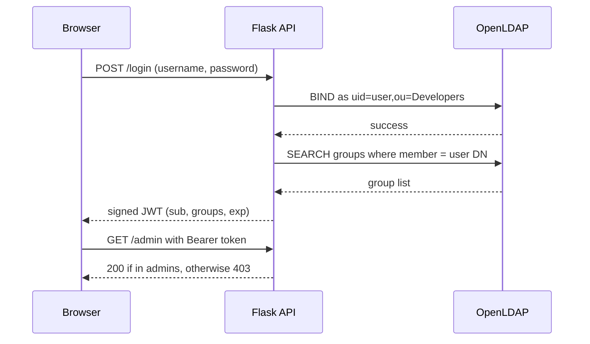

<h1 align="center">The Front Desk</h1>

<p align="center">
  <b>LDAP authentication and JWT authorization, made visible.</b><br>
  A real OpenLDAP directory verifies users. A signed JWT decides what they can access.
</p>

<p align="center">
  
  
  
  
</p>


---

## Demo

https://github.com/user-attachments/assets/9dd22995-2d1b-4470-adce-070d1651f5fd

## What it does

- **Register:** creates a real `inetOrgPerson` entry in the directory, with a salted-SHA password hash
- **Sign in:** validates credentials with an LDAP bind, not a database lookup
- **Get a badge:** receives a JWT carrying the user's LDAP group memberships
- **Open doors:** `/profile` needs a valid token, `/admin` needs the `admins` group
- **See everything:** a live trace panel shows each LDAP step, and an admin-only tree shows the directory

## How it works



## Quick start

```bash
docker compose up -d
docker cp ldif/users.ldif my-ldap:/tmp/users.ldif
docker exec my-ldap ldapadd -x -D "cn=admin,dc=example,dc=com" -w admin123 -f /tmp/users.ldif

python -m venv venv
venv\Scripts\activate        # Mac/Linux: source venv/bin/activate
pip install -r requirements.txt
python app.py
```

Open **http://localhost:5000**

| User | Password | Role |
|---|---|---|
| `dcohen` | `pass1234` | admin |
| `ylevi` | `pass5678` | regular user |

## Endpoints

| Route | Access |
|---|---|
| `POST /register` | public, creates an LDAP user |
| `POST /login` | public, returns a JWT |
| `GET /profile` | any valid token |
| `GET /admin` | token with `admins` group |
| `GET /api/directory` | token with `admins` group |

<details>
<summary><b>Project structure</b></summary>

```
app.py               Flask API and JWT logic
static/index.html    browser UI
ldif/users.ldif      seed directory data
docker-compose.yml   OpenLDAP container
requirements.txt     Python dependencies
```
</details>

<details>
<summary><b>What I learned building this</b></summary>

- How an LDAP bind authenticates a user against a directory tree
- How group membership in the directory can drive authorization
- How JWT signatures prevent tampering with claims
- How to turn a protocol flow into something a person can see
</details>

> Built for learning and demonstration. Credentials and secrets here are for local use only.
